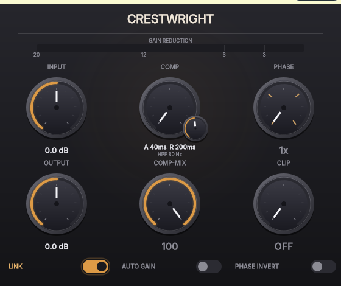

# Crestwright

常時オンの +5% アタック・トランジェントシェイパー + 2 段オールパス位相
モジュール + ワンノブ FET スタイル・コンプレッサー。ゼロレイテンシー。



## インターフェース

- **INPUT**：入力ゲイン、−24 dB ～ +24 dB
- **OUTPUT**：出力ゲイン、−24 dB ～ +24 dB
- **LINK**（既定でオン）：入力／出力の双方向リンク。INPUT を X dB 上げると OUTPUT が X dB 下がり、OUTPUT を動かすと INPUT が逆方向に追従します。スイッチをオンにした時点で、現在の INPUT に合わせてバランスを取ります
- **COMP**：コンプレッサーのマクロ。0 = 完全オフ、100 = 目標設定（8:1、アタック 10 ms、リリース 80 ms、メイクアップ最大 +10 dB）。現在のアタック／リリース時間はノブの下に表示されます
- **HPF**（COMP 右下の小さなノブ）：コンプレッサー検波器側のハイパスフィルター、20–400 Hz、既定 80 Hz。コンプレッサーが「聴く」信号だけを変え、出力音声は全帯域のままです。低域でコンプが反応しなくなります
- **COMP-MIX**：コンプレッサーのパラレル・ブレンド（0 = 位相処理のみ、100 = 完全にコンプ）。0–100 の整数で表示
- **PHASE**：位相深度。既定は **1x**。ノブは 1x / 2x / 3x / 4x にスナップし、対応する目盛りがあります。切り替え時は 30 ms でクロスフェード
- **CLIP**：独立したクリップ段、0–100。最小値は **OFF** で段全体をバイパス、100 = 最大。dB 表示はありません
- **AUTO GAIN**：自動レベル補正。オンにすると出力 RMS が入力 RMS に追従し、COMP / COMP-MIX / PHASE を変えても全体音量が変わりません
- **PHASE INVERT**：出力の極性反転（正確に 180°）
- **GAIN REDUCTION**：リアルタイム・ゲインリダクション・メーター（30 Hz 更新）。各区切り線の下に 3 / 6 / 12 / 20 dB を表示

信号経路：固定 +5% アタックシェイパー → INPUT → 位相カスケード → コンプレッサー（検波器の前に 12 dB/oct HPF）→ COMP-MIX → CLIP → AUTO GAIN → OUTPUT → PHASE INVERT

## ノブ操作

- **ダブルクリック**：ノブ中央にインライン入力ボックスが開き、現在値が全選択されます。Enter または別の場所をクリックで確定、Esc でキャンセル。入力によるパラメータ変更も LINK に追従します
- **Ctrl + 左クリック**：パラメータの既定値に戻す（INPUT/OUTPUT 0 dB、COMP 0、COMP-MIX 100、PHASE 1x、CLIP OFF、HPF 80 Hz）
- **Shift + 左ドラッグ**：4 倍細かい調整
- **Shift + マウスホイール**：最小ステップで調整（INPUT/OUTPUT 0.1 dB、CLIP/HPF 1、PHASE 1 段）

## コンプレッサー・マクロの対応

| パラメータ | comp=0 | comp=100 |
|---|---|---|
| しきい値 | -20 dB | -34 dB |
| 比率 | 1:1 | 8:1 |
| アタック | 40 ms | 10 ms |
| リリース | 200 ms | 80 ms |
| メイクアップ | 0 dB | 最大 +10 dB |

検波器はステレオリンクのピーク検波で、3 dB のソフトニーです。しきい値は音声レベルより約 14 dB 低いため、通常のレベル（ピークが 0 dBFS 付近）の素材でも、INPUT を 14 dB 上げなくても十分にコンプがかかります。

メイクアップは**ゲインリダクションに応じて段階的に**適用されます：`メイクアップ dB = 10 × (1 − e^(−GR/12))`。この値は常に現在の GR より小さいため、コンプレッサー全体のゲインが 1 を超えることはなく、アタックが追いつく前のフルスケール過渡でも 0 dBFS を超えません。コンプレッサーには tanh 飽和段もありません。倍音は CLIP を意図的に使ったときだけ発生します。

### サイドチェーン・ハイパス（HPF）

COMP 右下の小さなノブは、コンプレッサー検波器の前段にある 12 dB/oct バターワース・ハイパスを操作します：

- 範囲 20–400 Hz、既定 80 Hz
- フィルターは検波信号のみに作用し、音声経路は全帯域のまま
- COMP = 0 では完全に無影響（HPF 設定に関係なく出力はサンプル単位で同一）
- 60 Hz 正弦波・comp=100 の場合、HPF 20 Hz では強くコンプがかかり、HPF ≥150 Hz では低域がほとんどコンプをトリガーしません。2 kHz の信号は HPF の影響をほぼ受けません

## クリップ段

`y = thr · tanh(x / thr)`、しきい値は +16 dBFS（6.3）から −16.5 dBFS（0.15）へ指数関数的に変化します：

`thr = 6.3 × (0.15 / 6.3) ^ (CLIP / 100)`

CLIP = 0（OFF）では段全体が完全にバイパスされ、計算にも関与しません。フルスケールのドラム過渡も圧縮されません。CLIP = 100 ではしきい値が 0.15 まで下がり、明確なソフトクリップがかかります。小信号ゲインは常に 1 なので、CLIP を回しても静かな部分の音量は変わりません。

## オートゲイン

- サンプル単位の RMS（時定数 0.5 秒）でドライ入力と処理後の信号を比較
- ゲイン自体も時定数 0.8 秒でサンプル単位にスムージング
- ホストのブロックサイズに依存せず、連続再生時のレベルが安定
- 定常状態の出力レベルは入力に対して 0.1 dB 以内
- 無音時は現在のゲインを保持し、1 に戻ろうとしない
- COMP / COMP-MIX の変更後、約 4 秒で収束

## 位相モジュール

2 段の二次オールパスを従属接続しています。各段の f0 と Q は改訂版
リファレンス・プリセット（Band 1, 4）の値です。

| # | f0 (Hz) | Q |
|---|---|---|
| 1 | 60.220 | 0.555778 |
| 2 | 121.939 | 0.500000 |

- 各段は双一次変換（RBJ）の標準二次オールパス
- 純オールパス：実測の振幅偏差は 1e-6 dB 未満
- ゼロレイテンシー。係数は `prepare()` でサンプルレートから再計算
- 2x / 3x / 4x は同じ 2 段カスケードを 2 / 3 / 4 回繰り返す
- 切り替えは 30 ms の出力クロスフェード。4 つのタップは常時動作するため
  フィルター状態の不連続はありません
- 倍精度状態、極半径の上限 0.9995、NaN/Inf で自動リセット

合計位相の折返しが 35.133 Hz / 209 Hz になるよう、内部の中心周波数を
補正しています（プリセットの公称値は 40.068 / 183.340 Hz）。

純オールパスで、実測の振幅偏差は 1e-6 dB 未満です。1 kHz 以上の小さな
群遅延残差は、この 2 バンド構成に固有のものです。詳細は
`docs/PHASE-DESIGN.md` を参照してください。

## トランジェント・シェイパー

入力段の最も手前に固定のトランジェント・シェイパーがあります。常時オンで、
UI にコントロールはありません。アタックを最大 +5%（ゲイン 1.00 → 1.05、
約 +0.42 dB）持ち上げ、サステインには何もしません。定常音ではゲインが
正確に 1.00 に戻ります。ステレオリンク、ゼロレイテンシーです。

## フォント

インターフェースは **Inter**（SIL Open Font License 1.1、商用利用可）を使用しています。フォントファイルとライセンスは `Assets/Fonts/` にあります。

## 測定

- レイテンシー：0 サンプル
- CPU：comp=100 / 位相 4x で 1 コアの約 0.4%（48 kHz ステレオ）
- 位相モジュール単体：4x で 1 コアの 0.062%（48 kHz ステレオ）
- 位相の振幅偏差：10 Hz–20 kHz で最大 3.0e-7 dB
- 位相深度は厳密に線形：20 Hz で 14.28 / 28.55 / 42.83 / 57.11 ms（1x–4x）
- トランジェント・シェイパー：アタック最大 +5.00%（ゲイン 1.050、約 +0.42 dB）、
  定常時ゲイン 1.000、ゼロレイテンシー
- 位相反転：正確に 180.0°、レベル差 0.00 dB
- 入出力ゲイン精度：±0.03 dB
- LINK：INPUT / OUTPUT のどちらを動かしても総レベル変化は 0.00 dB
- CLIP = OFF：0 dBFS 正弦波でレベル変化 0.00 dB、ピーク 1.000（完全バイパス）
- COMP 下のアタック／リリース表示は常に整数ミリ秒
- サイドチェーン HPF の係数はブロックごとに 25% でスムージングされ、ジッパーノイズなし
- COMP = 100、0 dBFS 正弦波：THD ≈ 0.04%、コンプのゲインは常に 1 以下でクリップなし
- CLIP = 100、−6 dBFS 正弦波：THD ≈ 27%

## 読み込み性能

- フォントはプロセスごとに一度だけ解析してキャッシュ（インスタンスごとではない）
- 位相深度の切り替えは 30 ms クロスフェードでクリックなし
- インスタンス起動時は保存された位相ポジションから始まり、2x からフェードインしない
- 更新時に Cubase が起動していて古いバンドルが残った場合は、Cubase を終了して `cleanup_old.bat` を実行
- 同じプラグイン ID の残骸があると Cubase のスキャン／読み込みが遅くなるため、`Crestwright.vst3` は 1 つだけにしてください

## インストーラー

`dist\Crestwright_Setup_1.2.1.exe`

内容：
- VST3 プラグイン → `C:\Program Files\Common Files\VST3\Crestwright.vst3`
- スタンドアロン → `C:\Program Files\Crestwright\Crestwright.exe`
- スタートメニューのショートカットとアンインストール項目

インストーラーの UI は英語です（Inno Setup の言語パックに簡体字中国語が含まれていないため）。スクリプトは `installer\Crestwright.iss` にあり、バージョンやファイルを変更したら再ビルドしてください。

## 手動インストール

`dist\Crestwright.vst3` を `C:\Program Files\Common Files\VST3\` に直接コピーしても構いません。

## ビルド

```
build.bat
```

VS2022 MSVC、Ninja、JUCE 9 が必要です。JUCE は既定で `D:\JUCE` から読み込みます。別の場所を使う場合は CMake に `-DJUCE_DIR=<path>` を渡してください。

`build/` と `dist/` はバージョン管理対象外です。インストーラーは GitHub Releases で配布してください。

## ライセンス

Crestwright は自由ソフトウェアです。GNU Affero General Public License（AGPLv3、
またはそれ以降）の条件に従って、再配布および／または改変できます。

本プログラムは有用であることを願って配布されますが、いかなる保証もありません。
商品性や特定目的への適合性についても保証しません。詳細は GNU Affero General
Public License を参照してください。

ライセンス全文は [LICENSE](LICENSE) に含まれています。https://www.gnu.org/licenses/
からも取得できます。

完全な対応ソース：https://github.com/Linning8594/Crestwright

サードパーティ製コンポーネントとそのライセンス：[THIRD-PARTY-NOTICES.md](THIRD-PARTY-NOTICES.md)
