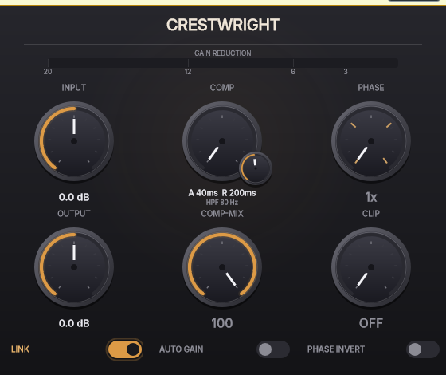

# Crestwright

A six-section allpass phase module plus a single-knob FET-style compressor.
Zero latency.



## Interface

- **INPUT**: input gain, −24 dB .. +24 dB
- **OUTPUT**: output gain, −24 dB .. +24 dB
- **LINK** (on by default): bidirectional input/output linking. Raise INPUT by X dB and OUTPUT drops by X dB; turning OUTPUT moves INPUT the opposite way. Enabling the switch immediately balances the pair against the current INPUT value
- **COMP**: compressor macro. 0 = fully off; 100 = the target setting (8:1, 10 ms attack, 80 ms release, up to +10 dB make-up). The current attack / release times are shown under the knob
- **HPF** (small knob at the bottom-right of COMP): high-pass filter in the compressor's detector path, 20–400 Hz, default 80 Hz. It only changes what the compressor "hears" — the output audio stays full-range, so low frequencies no longer trigger compression
- **COMP-MIX**: parallel compressor blend (0 = phase processing only, 100 = fully compressed), displayed as an integer from 0–100
- **PHASE**: phase depth, default **1x**. The knob snaps to 1x / 2x / 3x / 4x with matching tick marks; depth changes crossfade over 30 ms
- **CLIP**: dedicated clipping stage, 0–100. The lowest position is **OFF** and bypasses the stage; 100 = maximum. No dB values are displayed
- **AUTO GAIN**: automatic level matching. When enabled, the output RMS follows the input RMS, so changing COMP / COMP-MIX / PHASE does not change the overall level
- **PHASE INVERT**: output polarity inversion (exact 180°)
- **GAIN REDUCTION**: real-time gain-reduction meter (30 Hz refresh), with every divider line labelled 3 / 6 / 12 / 20 dB

Signal path: INPUT → phase cascade → compressor (12 dB/oct HPF in front of the detector) → COMP-MIX → CLIP → AUTO GAIN → OUTPUT → PHASE INVERT

## Knob controls

- **Double-click**: an inline text box opens in the middle of the knob with the current value selected. Enter or clicking elsewhere applies it; Esc cancels. Values entered this way still follow LINK
- **Ctrl + left-click**: restore the parameter default (INPUT/OUTPUT 0 dB, COMP 0, COMP-MIX 100, PHASE 1x, CLIP OFF, HPF 80 Hz)
- **Shift + left-drag**: 4× finer adjustment
- **Shift + mouse wheel**: step by the smallest increment (INPUT/OUTPUT 0.1 dB, CLIP/HPF 1, PHASE one position)

## Compressor macro mapping

| Parameter | comp=0 | comp=100 |
|---|---|---|
| Threshold | -20 dB | -34 dB |
| Ratio | 1:1 | 8:1 |
| Attack | 40 ms | 10 ms |
| Release | 200 ms | 80 ms |
| Make-up | 0 dB | up to +10 dB |

The detector is a stereo-linked peak detector with a 3 dB soft knee. The
threshold sits about 14 dB below the audio level, so material at ordinary
levels (peaks near 0 dBFS) compresses noticeably without pushing INPUT up
by 14 dB.

Make-up is applied **progressively with the gain reduction**:
`make-up dB = 10 × (1 − e^(−GR/12))`. Because that value is always smaller
than the current GR, the compressor's overall gain can never exceed unity,
so full-scale transients cannot be pushed past 0 dBFS before the attack
catches up. The compressor no longer contains a tanh saturation stage
either; extra harmonics only appear when you use CLIP deliberately.

### Sidechain high-pass (HPF)

The small knob at the bottom-right of COMP controls a 12 dB/oct Butterworth
high-pass in front of the compressor detector:

- Range 20–400 Hz, default 80 Hz
- The filter only affects the detection signal; the audio path stays full-range
- COMP = 0 is completely unaffected (output is sample-identical regardless of the HPF setting)
- With a 60 Hz sine at comp=100, HPF 20 Hz compresses strongly; at HPF ≥150 Hz the low end barely triggers compression. A 2 kHz signal is essentially unaffected by the HPF

## Clipping stage

`y = thr · tanh(x / thr)`, with the threshold sweeping exponentially from
+16 dBFS (6.3) down to −16.5 dBFS (0.15):

`thr = 6.3 × (0.15 / 6.3) ^ (CLIP / 100)`

At CLIP = 0 (OFF) the stage is bypassed completely and takes no part in the
calculation, so even full-scale drum transients are untouched. At CLIP = 100
the threshold drops to 0.15 for obvious soft clipping. The small-signal gain
is always 1, so turning CLIP never changes the level of quiet passages.

## Auto Gain

- Per-sample RMS (0.5 s time constant) compares the dry input with the processed signal
- The gain itself is smoothed per sample with a 0.8 s time constant
- Independent of the host block size; level stays consistent during continuous playback
- Steady-state output level is within 0.1 dB of the input
- Holds the current gain through silence instead of drifting back to 1
- Converges within about 4 seconds after a COMP / COMP-MIX change

## Phase module

The module is a cascade of six second-order allpass sections. The frequency
and Q of every section are taken from the revised reference preset (bands
1, 4, 7, 2, 3 and 5); the cascade is repeated for the 1x / 2x / 3x / 4x depth
switch.

| # | f0 (Hz) | Q |
|---|---|---|
| 1 | 21.272 | 0.479995 |
| 2 | 169.033 | 0.469874 |
| 3 | 447.819 | 0.477733 |
| 4 | 892.054 | 0.376757 |
| 5 | 1873.367 | 0.471898 |
| 6 | 6367.351 | 0.475947 |

- Each section is the standard bilinear (RBJ) second-order allpass
  `H(z) = (a2 + a1 z⁻¹ + z⁻²) / (1 + a1 z⁻¹ + a2 z⁻²)`
- Pure allpass: measured magnitude error is below 1e-6 dB
- Zero latency; coefficients are recalculated from the sample rate in
  `prepare()` and never allocated afterwards
- Depth 2x/3x/4x runs the same six-section cascade two/three/four times
- Depth changes crossfade over 30 ms; all four taps keep running so the
  switch is a pure output crossfade with no filter-state discontinuity
- Double precision state, pole radius capped at 0.9995, automatic reset on
  NaN/Inf

Measured group delay (1x, 44.1 kHz):

| Hz | 20 | 30 | 50 | 80 | 100 | 150 | 200 | 300 | 500 | 1k |
|---|---|---|---|---|---|---|---|---|---|---|
| ms | 22.06 | 16.40 | 10.97 | 7.85 | 6.77 | 5.19 | 4.25 | 3.09 | 1.94 | 0.96 |

The phase module is a pure allpass; measured magnitude error is below 1e-6 dB.
The small residual group delay above 1 kHz is inherent to the six-band design.
See `docs/PHASE-DESIGN.md` for the full verification record.

The original preset file is not part of this repository; only the derived
frequency and Q table above is published.

## Fonts

The interface uses **Inter** (SIL Open Font License 1.1, free for commercial
use). The font files and licence are in `Assets/Fonts/`.

## Measurements

- Latency: 0 samples (the phase module's first impulse-response sample is at n = 0)
- CPU: about 0.5% of one core at comp=100 and phase 4x (48 kHz stereo)
- Phase module alone: 0.175% of one core at depth 4x (48 kHz stereo, 4 passes)
- Phase magnitude: max deviation 4.9e-7 dB over 10 Hz–20 kHz
- Phase depth scaling is exactly linear: 22.06 / 44.13 / 66.19 / 88.25 ms
  at 20 Hz for 1x / 2x / 3x / 4x
- Depth switching: no sample-level discontinuity (max step stays at the
  natural slope of the test sine); NaN/Inf input recovers immediately
- Phase invert: exact 180.0°, 0.00 dB level difference
- Input / output gain accuracy: ±0.03 dB
- LINK: total level change is 0.00 dB whether INPUT or OUTPUT is moved
- CLIP = OFF: 0.00 dB level change and peak 1.000 on a 0 dBFS sine (true bypass)
- The Attack / Release readout under COMP always shows whole milliseconds
- Sidechain HPF coefficients are smoothed at 25% per block, with no zipper noise
- COMP = 100 on a 0 dBFS sine: THD ≈ 0.04%, and the compressor gain never exceeds unity, so there is no clipping
- CLIP = 100 on a −6 dBFS sine: THD ≈ 27%

## Loading performance

- Fonts are parsed once per process and cached, not once per instance
- Phase depth changes use a 30 ms crossfade and never click
- An instance starts on the phase position stored in the project instead of fading in from 2x
- If Cubase was running during an update and left an old bundle behind, close Cubase and run `cleanup_old.bat`
- Leftover bundles with duplicate plugin IDs make Cubase scan/load slowly; keep only one `Crestwright.vst3`

## Installer

`dist\Crestwright_Setup_1.1.0.exe`

Contents:
- VST3 plugin → `C:\Program Files\Common Files\VST3\Crestwright.vst3`
- Standalone application → `C:\Program Files\Crestwright\Crestwright.exe`
- Start-menu shortcuts and an uninstall entry

The installer UI is English (the Inno Setup language packs do not include Simplified Chinese).
The script lives in `installer\Crestwright.iss`; rebuild it after changing the version or files.

## Manual installation

You can also copy `build\Crestwright_artefacts\Release\VST3\Crestwright.vst3` directly to
`C:\Program Files\Common Files\VST3\`.

## Building

```
build.bat
```

Requires VS2022 MSVC, Ninja and JUCE 9. JUCE is read from `D:\JUCE` by default;
pass `-DJUCE_DIR=<path>` to CMake to use a different location.

`build/` and `dist/` are not tracked; publish installers through GitHub Releases.

## Contributing

Contributions are welcome. See [CONTRIBUTING.md](CONTRIBUTING.md) for the build
and test workflow and the licence of contributions. For security reports, see
[SECURITY.md](SECURITY.md). User-visible changes are listed in
[CHANGELOG.md](CHANGELOG.md). Please also read
[CODE_OF_CONDUCT.md](CODE_OF_CONDUCT.md).

## License

Crestwright — Copyright (c) 2026 Linning.

Crestwright is free software: you can redistribute it and/or modify it under the
terms of the GNU Affero General Public License as published by the Free Software
Foundation, either version 3 of the License, or (at your option) any later
version.

This program is distributed in the hope that it will be useful, but WITHOUT ANY
WARRANTY; without even the implied warranty of MERCHANTABILITY or FITNESS FOR A
PARTICULAR PURPOSE. See the GNU Affero General Public License for more details.

The full licence text is in [LICENSE](LICENSE). You can also obtain it from
<https://www.gnu.org/licenses/>.

Complete corresponding source: <https://github.com/Linning8594/Crestwright>

Third-party components and their licences: see
[THIRD-PARTY-NOTICES.md](THIRD-PARTY-NOTICES.md).
